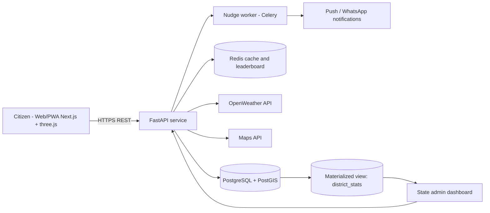
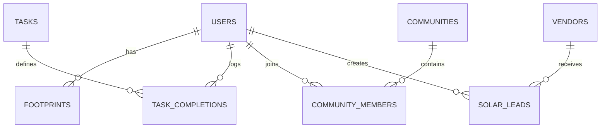

# 🌿 Mission LiFE Companion
Personal sustainability companion for **GEDA – Mission LiFE** (HC26-GEDA01). Measure your footprint, get peak-hour nudges, earn points with your community, and check rooftop-solar feasibility.

**Live prototype:** https://claude.ai/artifact/EpkzMc19GgRZPht4Xe953L

## Problem targeted
HC26-GEDA01: citizens lack personalised, actionable tools to measure their footprint, get real-time energy-saving suggestions and see the impact of their actions. This app operationalises Mission LiFE as a personal sustainability companion.

## Features
Footprint tracker · contextual nudges and daily micro-tasks · leaderboard and community goals · solar calculator and vendor directory · state admin dashboard · 3D globe that turns greener as you earn points · what-if simulator · streaks and badges · spoken voice guide (sound is off by default).

## Architecture


## Database schema

Full DDL: [`db/schema.sql`](db/schema.sql).

## Tech stack
| Layer | Choice | Why |
|---|---|---|
| Frontend | Next.js + three.js (PWA) | fast, installable, 3D visuals |
| Backend | FastAPI (Python) | typed, async, auto OpenAPI docs |
| Data | PostgreSQL + PostGIS, Redis | relational integrity, geo search, fast leaderboards |
| Integrations | OpenWeather, Maps | solar irradiance, nearby vendors |

## Setup
```bash
cd backend && pip install -r requirements.txt
uvicorn app.main:app --reload      # docs at http://localhost:8000/docs
pytest                              # run from backend/
psql -f ../db/schema.sql            # needs PostgreSQL with PostGIS
```
Frontend: open `frontend/index.html` in a browser (no build step; loads three.js from a CDN).

## Run with Docker
```bash
docker compose up --build   # API on :8000, PostGIS and Redis started
```
CI (GitHub Actions) runs the tests on every push.

## Scalability
Stateless API behind a load balancer; Redis sorted sets for leaderboards; per-district aggregation via a materialized view refreshed on a schedule; nudges computed by background workers, not request threads; a unique constraint on (user, task, day) prevents duplicate points.

## Limitations
Emission factors and subsidy values are indicative; task completion is self-declared in the prototype; vendor and leaderboard data are demo data; no auth yet.

## Roadmap
1. OTP auth and persistence. 2. Smart-meter / bill-photo verification. 3. Live OpenWeather and Maps. 4. Gujarati and Hindi. 5. ML-based personalised nudges. 6. Official GEDA vendor registry integration.

## API
`POST /v1/footprint` · `POST /v1/solar/estimate` · `GET /health` (see `/docs`).

## Libraries and APIs
three.js r128 (3D background), Web Speech API and WebAudio (voice guide, browser built-ins), FastAPI, Pydantic, pytest. Planned: OpenWeather API, Google Maps API, PostgreSQL/PostGIS, Redis, Celery.

## Design research
Before building, we reviewed popular footprint and habit apps. Common patterns: footprint calculators, challenges, community competition. We kept features that connect points to visible CO2 impact and avoided points-only gamification.
